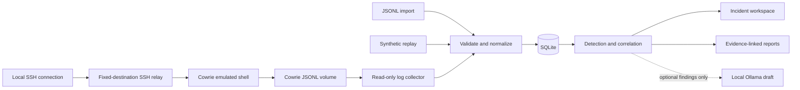

# Aegis

**An evidence-first SOC and deception lab.** Import or collect Cowrie telemetry, inspect explainable detections, follow incident timelines, and export analyst reports.

This is a working local v0.1, with a real Cowrie sensor and a separate synthetic demo. It is intended for learning, defensive research, and repeatable portfolio demonstrations.

## Start the complete lab

Requires Docker Engine and Docker Compose.

```bash
docker compose up -d --build
```

Open **http://127.0.0.1:8000**, then click **Replay demo**. The SSH honeypot entry point is bound to **127.0.0.1:2222**. The dashboard and SSH entry point are not published on other host interfaces.

```bash
docker compose logs --tail 30
docker compose down
```

Stopping the stack preserves its named volumes. The dashboard database lives in `aegis-data`; original Cowrie logs live in `cowrie-log`. Cowrie's image is pinned to the digest verified during development (Cowrie 3.1.1).

## Try the demo

1. Click **Replay demo** to ingest 18 synthetic observations. Replay generates no connections, commands, or downloads.
2. Select **Login following repeated failures** to inspect the authentication sequence and discovery observation.
3. Follow an evidence link to its source event. Open **Detection rules** to see the precise trigger.
4. Change an incident to **Investigating** or **Resolved**. The workflow persists in SQLite.
5. Click **Export report** for a Markdown report containing rule findings and evidence IDs.
6. Open **Lab & validation**, then **Replay & evaluate**. The fixture has three expected positive sessions and two expected negative sessions.

Replays are idempotent. Demo and imported telemetry have separate namespaces and never correlate with one another.

## Features shipped

- Cowrie JSONL file import with atomic validation, a 2 MB / 5,000-line request limit, canonical timestamps, stable event IDs, and deduplication.
- Local collector polling the shared Cowrie log, with restart-safe deduplication, inode/size-based rotation handling, and partial/oversized-line handling.
- Four deterministic rules: repeated failures, login after failures, system discovery commands, and completed downloads.
- Cross-session authentication correlation within a sensor/source/time window; incident grouping by dataset, sensor, source address, and session.
- Incident queue, severity/search filters, searchable events, candidate ATT&CK mappings, source-event timelines, and persistent triage status.
- Rule-based report export and an optional local Ollama draft, clearly distinguished in the interface.
- Responsive dashboard, keyboard focus states, escaped event content, CSRF protection, trusted-host checks, and a restrictive content security policy.

## Architecture



Cowrie joins only an internal Docker network, with no default route. The relay joins the frontend and internal networks, has IP forwarding disabled, and forwards a TCP connection only to `cowrie:2222`. The dashboard reads a shared log volume; it does not join Cowrie's network. The relay limits concurrent forwarded sessions to 16 and session lifetime to five minutes.

**Source attribution limitation:** Cowrie sees the relay's address for live sessions. This deployment is a local lab, so live source attribution and per-IP authentication correlation do not distinguish clients behind that relay. Imported logs preserve their recorded source addresses. This topology is not suitable for an Internet honeypot without additional design and validation.

## Run the dashboard without Docker

Requires Python 3.11 or newer.

```bash
python3 -m venv .venv
.venv/bin/pip install -r requirements.txt
.venv/bin/python app.py
```

The app binds to `127.0.0.1:8000`. SQLite defaults to `data/aegis.sqlite3`. Optional settings:

| Variable | Purpose | Default |
| --- | --- | --- |
| `AEGIS_DB` | SQLite path | `data/aegis.sqlite3` |
| `AEGIS_PORT` | HTTP port | `8000` |
| `AEGIS_BIND` | HTTP listen address | `127.0.0.1` |
| `AEGIS_COWRIE_LOG` | Local Cowrie JSONL file to follow | Disabled |
| `AEGIS_OLLAMA_MODEL` | Installed local Ollama model name | Disabled |
| `AEGIS_OLLAMA_URL` | Loopback Ollama HTTP address | `http://127.0.0.1:11434` |

For a local Cowrie installation, set `AEGIS_COWRIE_LOG` to its JSON log before starting the app. Click **Refresh** to see new events; the browser does not poll automatically.

## Import format

Choose **Import Cowrie log** and select a UTF-8 JSONL file. Every accepted event requires `timestamp` with a timezone, `eventid`, `sensor`, `session`, and `src_ip`. For example:

```json
{"timestamp":"2026-10-05T14:30:00Z","eventid":"cowrie.command.input","sensor":"ssh-lab-01","session":"lab-observation","src_ip":"192.0.2.10","input":"hostname"}
```

The normalizer retains a limited set of relevant fields. Passwords, raw login messages, SSH keys, and unknown fields are not copied into Aegis. Recorded command text and URLs may still contain sensitive information. Original Cowrie logs are untouched and can contain credentials; handle that volume as sensitive lab data.

One invalid file record rejects the entire import, with a line number. The collector skips unsupported records and reports its last poll's skipped count in **Lab & validation**. Operational Cowrie events without session/source fields are not supported by this normalizer.

## Optional local AI

Run the Python dashboard on the same host as an existing Ollama installation. Set `AEGIS_OLLAMA_MODEL` to a model already available there, then restart Aegis. The **Generate AI draft** button becomes available. Aegis does not download models automatically.

Only rule descriptions and evidence IDs are sent to the model; raw attacker command text, credentials, IPs, and URLs are excluded. Requests use the local `/api/generate` endpoint, a 45-second timeout, and a single-request concurrency limit. Redirects and non-loopback endpoints are rejected. Generated text is displayed as an unverified draft and never changes findings or triggers actions.

The default Docker setup has no AI model service. Its loopback address refers to the dashboard container, so use the native Python mode for this optional integration. The adapter has mocked tests; real-model output quality and latency have not been validated. There is no Astra integration in v0.1.

## Validation

```bash
python3 -m pip install -r requirements-dev.txt
python3 -m pytest -q
python3 -m playwright install chromium
python3 tests/browser_smoke.py
```

The browser smoke test expects the Compose stack at port 8000. It checks the SSH banner and collector, then replay, incident selection, status persistence, export, search, rule display, fixture evaluation, import escaping, and mobile overflow. It writes screenshots to `test-results/` and adds clearly named test telemetry. Set `AEGIS_TEST_URL` to a different local dashboard URL to skip the Compose SSH check.

See [verification notes](docs/VERIFICATION.md) for completed checks and interpretation limits.

## Current boundaries and next milestones

This is a single-user local lab using Flask's development server. It has no user accounts, TLS, production retention system, high-throughput streaming engine, or automated incident response. The event cap is 50,000; detection is recomputed from stored events on reads. It is designed for small datasets, not sustained hostile traffic.

Recorded input does not prove successful command execution. Downloads do not establish malware or C2. Discovery can be benign; rule severity is priority, not a probability. ATT&CK mappings are candidates for review. Deduplication can collapse otherwise identical records sharing a timestamp. Collector rotation supports rename/create or observed truncation; copy-truncate followed by rapid regrowth can evade a size-based reset.

Next milestones: evaluate against independent labeled telemetry; improve detection coverage and performance; add authenticated multi-user deployment; validate model explanations; add a second telemetry source and cross-source incident correlation. Adaptive deception, network beaconing detection, and malware analysis are later modules.

## References

- [Cowrie event reference](https://docs.cowrie.org/en/stable/OUTPUT.html): normalization schema.
- [Cowrie Docker documentation](https://docs.cowrie.org/en/latest/docker/README.html): sensor image and configuration.
- [MITRE ATT&CK detection strategies](https://attack.mitre.org/detectionstrategies/): defensive detection context.
- [Ollama generate endpoint](https://docs.ollama.com/api/generate): optional local model adapter.
