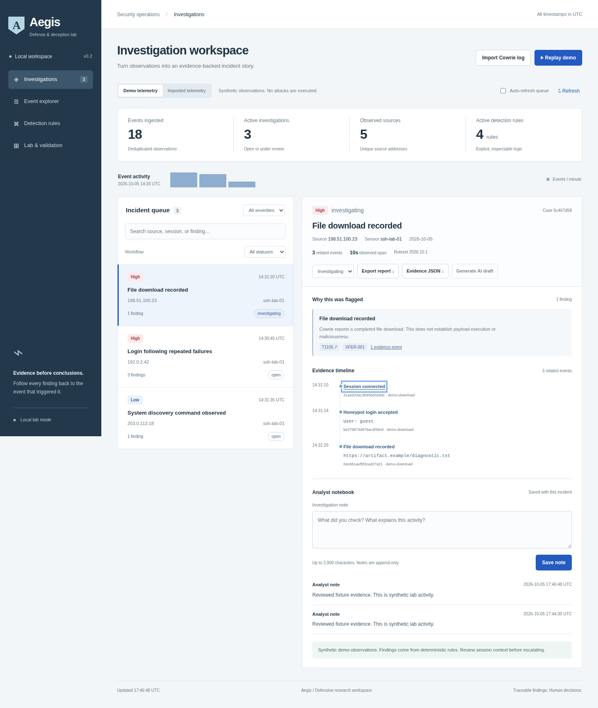
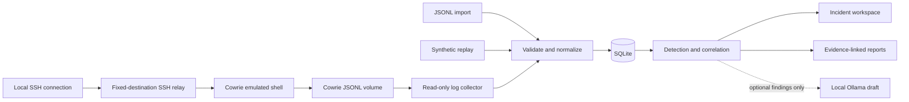

# Aegis

**An evidence-first SOC and deception lab.** Import or collect Cowrie telemetry, inspect explainable detections, follow incident timelines, and export analyst reports.

This is Aegis 2.0, in development on `main`. It is not production-ready: open release gates are tracked in the [2.0 audit](docs/AEGIS_2_0_REPO_AUDIT.md#7-release-gate-status-snapshot-spec-17). The 1.0 lab, including the AWS honeypot deployment, is preserved on the `aegis-1.0` branch. Aegis runs a real Cowrie sensor with a separate synthetic demo and is intended for learning, defensive research, and repeatable portfolio demonstrations.



## Start the complete lab

Requires Docker Engine and Docker Compose.

```bash
docker compose up -d --build
```

Open **http://127.0.0.1:8000**, then click **Replay demo**. The SSH honeypot entry point is bound to **127.0.0.1:2222**. The dashboard and SSH entry point are not published on other host interfaces.

```bash
docker compose logs --tail 30
docker compose down
```

Stopping the stack preserves its named volumes. The dashboard database lives in `aegis-data`; original Cowrie logs live in `cowrie-log`. Cowrie's image is pinned to the digest verified during development (Cowrie 3.1.1).

## Try the demo

1. Click **Replay demo** to ingest 18 synthetic observations. Replay generates no connections, commands, or downloads.
2. Select **Login following repeated failures** to inspect the authentication sequence and discovery observation.
3. Follow an evidence link to its source event. Open **Detection rules** to see the precise trigger.
4. Change an incident to **Investigating** or **Resolved**. The workflow persists in SQLite.
5. Click **Export report** for a Markdown report containing rule findings and evidence IDs.
6. Add an investigation note in the **Analyst notebook**. Status changes and notes are retained with the case and included in both exports.
7. Open **Lab & validation** to inspect thirty-one regression checks and the statistical baseline status and the five-session demo evaluation. These checks can run without importing data.

Replays are idempotent. Demo and imported telemetry have separate namespaces and never correlate with one another.

## Features shipped

- Cowrie JSONL file import with atomic validation, a 2 MB / 5,000-line request limit, canonical timestamps, stable event IDs, and deduplication.
- Live collector with a durable checkpoint (file identity + byte offset) committed in the same transaction as its events; it resumes after restart, drains rename-rotated files (and finds them again by inode after a restart), resets on truncation, waits for partial lines, quarantines malformed or oversized lines without storing their content, and backs off without advancing when storage is unavailable.
- Hash-chained raw evidence: the original record bytes, a SHA-256 digest, and provenance (ingestion mode, source, file identity, record locator, parser and schema versions) for every live, uploaded, or synthetic record, with a verification endpoint. See the [evidence and retention policy](docs/EVIDENCE_POLICY.md).
- Separate `demo`, `imported`, and `live` datasets; versioned schema migrations; liveness, readiness, and per-source health endpoints.
- Five versioned, configurable rules (repeated failures, login after failures, discovery commands, completed downloads, SCP/SFTP uploads) and two ordered sequences (login → discovery → transfer; failures → login → shell input). Every finding stores its exact evidence, machine-readable facts, rule version, and severity rationale. See the [detection reference](docs/DETECTION.md).
- Statistical signals (median/MAD robust baselines, no lookahead, explicit cold-start status): sensor event-rate spikes, username breadth per source, command volume and duration per session. Signals are low severity, carry a robust z-score kept apart from severity, and never create incidents on their own.
- Optional Isolation Forest scoring (off by default): manual, window-bounded training with a manifest; integrity-checked, fail-closed loading; scores reported as training percentiles, never probabilities. See the [ML section](docs/DETECTION.md#optional-ml-layer-c).
- Investigation workspace: event filters (type, session, sensor, source, UTC time range) with a spreadsheet-safe CSV export; per-event provenance with the original record (passwords masked); a session view with ordered timeline, linked findings, and analyst labels with history; Findings and Sources views.
- Labeled-dataset export of real telemetry (`python -m aegis.labels export`) and ML threshold calibration on later labeled data (`python -m aegis.ml calibrate`).
- Offline evaluation harness for labeled datasets: precision, recall, F1, false-positive rate, and confusion matrices per engine, rule, detection type, and sensor, with time-separated scoring and stated limitations. See [EVALUATION.md](docs/EVALUATION.md).
- Evidence fusion: findings sharing a session form one incident; brute-force bursts are one finding, not one case per window. Address-only links are labeled weak. Findings and incidents are persisted and updated after every commit, including late or out-of-order events.
- Incident queue with severity, workflow, and text filters; paginated event search; full event inspection; candidate ATT&CK mappings; and source-event timelines.
- Validated workflow (open, investigating, resolved, false positive) with actor and before/after values for every change; append-only notes; JSON evidence export (schema 2) with per-event provenance and the evidence-chain head.
- Rule-based report export and an optional local Ollama draft, clearly distinguished in the interface.
- Responsive dashboard, keyboard focus states, escaped event content, CSRF protection, trusted-host checks, and a restrictive content security policy.

## Architecture



Cowrie joins only an internal Docker network, with no default route. The relay joins the frontend and internal networks, has IP forwarding disabled, and forwards a TCP connection only to `cowrie:2222`. The dashboard reads a shared log volume; it does not join Cowrie's network. The relay limits concurrent forwarded sessions to 16 and session lifetime to five minutes.

**Source attribution limitation:** Cowrie sees the relay's address for live sessions. This deployment is a local lab, so live source attribution and per-IP authentication correlation do not distinguish clients behind that relay. Imported logs preserve their recorded source addresses. This topology is not suitable for an Internet honeypot without additional design and validation.

## Run the dashboard without Docker

Requires Python 3.11 or newer.

```bash
python3 -m venv .venv
.venv/bin/pip install -r requirements.txt
.venv/bin/python app.py
```

The app binds to `127.0.0.1:8000`. SQLite defaults to `data/aegis.sqlite3`. Optional settings:

| Variable | Purpose | Default |
| --- | --- | --- |
| `AEGIS_DB` | SQLite path | `data/aegis.sqlite3` |
| `AEGIS_PORT` | HTTP port | `8000` |
| `AEGIS_BIND` | HTTP listen address | `127.0.0.1` |
| `AEGIS_COWRIE_LOG` | Local Cowrie JSONL file to follow | Disabled |
| `AEGIS_SOURCE_ID` | Provenance name for the live collector | `cowrie-live` |
| `AEGIS_ML_MODEL_DIR` | Verified Isolation Forest model directory (used only with `"ml_enabled": true`) | Unset |
| `AEGIS_DETECTION_CONFIG` | JSON file with detection thresholds ([reference](docs/DETECTION.md#configuration)) | Built-in defaults |

Startup fails with a clear message if `AEGIS_COWRIE_LOG` points at Cowrie's diagnostic `cowrie.log`, at a directory, or into a missing directory, or if `AEGIS_SOURCE_ID` is not 1–64 lowercase letters, digits, `.`, `_`, or `-`. On SIGTERM (`docker stop`) the collector finishes its current batch before the process exits.
| `AEGIS_OLLAMA_MODEL` | Installed local Ollama model name | Disabled |
| `AEGIS_OLLAMA_URL` | Loopback Ollama HTTP address | `http://127.0.0.1:11434` |
| `AEGIS_OLLAMA_TIMEOUT` | Ollama request timeout in seconds | `45` |

For a local Cowrie installation, set `AEGIS_COWRIE_LOG` to its JSON log before starting the app. Click **Refresh** to update all visible data, or enable **Auto-refresh queue** for 15-second queue and counter updates. Background refresh deliberately leaves the open evidence panel and unsaved notes alone. Notes survive in-app navigation and refreshes, but unsaved drafts are not persisted across browser reloads. A leave-page prompt protects nonempty drafts.

## Import format

Choose **Import Cowrie log** and select a UTF-8 JSONL file. Every accepted event requires `timestamp` with a timezone, `eventid`, `sensor`, `session`, and `src_ip`. For example:

```json
{"timestamp":"2026-10-05T14:30:00Z","eventid":"cowrie.command.input","sensor":"ssh-lab-01","session":"lab-observation","src_ip":"192.0.2.10","input":"hostname"}
```

The normalizer retains a limited set of relevant fields. Passwords, raw login messages, SSH keys, and unknown fields are not copied into Aegis. Recorded command text and URLs may still contain sensitive information. Original Cowrie logs are untouched and can contain credentials; handle that volume as sensitive lab data.

One invalid file record rejects the entire import, with a line number. The collector skips unsupported records and reports its last poll's skipped count in **Lab & validation**. Operational Cowrie events without session/source fields are not supported by this normalizer.

## Optional local AI

Run the Python dashboard on the same host as an existing Ollama installation. Set `AEGIS_OLLAMA_MODEL` to a model already available there, then restart Aegis. The **Generate AI draft** button becomes available. Aegis does not download models automatically.

Only rule descriptions and evidence IDs are sent to the model; raw attacker command text, credentials, IPs, and URLs are excluded. Requests use the local `/api/generate` endpoint, a 45-second timeout by default (`AEGIS_OLLAMA_TIMEOUT`), and a single-request concurrency limit. Redirects and non-loopback endpoints are rejected. Generated text is displayed as an unverified draft and never changes findings or triggers actions.

The default Docker setup has no AI model service. Its loopback address refers to the dashboard container, so use the native Python mode for this optional integration. The adapter has mocked tests; real-model output quality and latency have not been validated. There is no Astra integration in this version.

## Validation

```bash
python3 -m pip install -r requirements-dev.txt
python3 -m pytest -q
python3 -m aegis.evaluate
python3 -m aegis.labeled_eval path/to/labeled-dataset   # see docs/EVALUATION.md
python3 -m aegis.ml train --help                         # optional ML layer, see docs/DETECTION.md
python3 -m playwright install chromium
python3 tests/browser_smoke.py
```

The browser smoke test expects the Compose stack at port 8000. It checks the SSH banner and collector, then replay, incident selection, status and note persistence, draft preservation, event inspection, both exports, search, workflow filters, rule display, fixture evaluation, import escaping, and mobile overflow. It writes screenshots to `test-results/` and adds clearly named test telemetry. Set `AEGIS_TEST_URL` to a different local dashboard URL to skip the Compose SSH check.

See [verification notes](docs/VERIFICATION.md) for completed checks and interpretation limits.

## Current boundaries and next milestones

This is a single-user local lab using Flask's development server. It has no user accounts, TLS, production retention system, high-throughput streaming engine, or automated incident response. The event cap is 50,000; detection is recomputed from stored events on reads. It is designed for small datasets, not sustained hostile traffic.

Discovery parsing recognizes simple shell command positions and ignores quoted lookalikes and interactive stdin. It is intentionally not a full shell parser and will miss some wrappers, expansions, or obfuscation.

Recorded input does not prove successful command execution. Downloads do not establish malware or C2. Discovery can be benign; rule severity is priority, not a probability. ATT&CK mappings are candidates for review. Deduplication can collapse otherwise identical records sharing a timestamp. Collector rotation supports rename/create (lossless, including across restarts while the rotated file stays in the same directory) or observed truncation; copy-truncate followed by rapid regrowth can evade a size-based reset, and lines written just before a copy-truncate can be lost. The raw evidence table holds attempted passwords; protect the database file.

For the current local-lab scope, the remaining validation work is independent labeled telemetry and real local-model testing. Multi-user deployment, additional sensors, adaptive deception, and malware analysis remain optional future projects rather than requirements for this release.

## References

- [Cowrie event reference](https://docs.cowrie.org/en/stable/OUTPUT.html): normalization schema.
- [Cowrie Docker documentation](https://docs.cowrie.org/en/latest/docker/README.html): sensor image and configuration.
- [MITRE ATT&CK detection strategies](https://attack.mitre.org/detectionstrategies/): defensive detection context.
- [Ollama generate endpoint](https://docs.ollama.com/api/generate): optional local model adapter.

## Practical API reference

GET endpoints are available on the local dashboard. Mutations require the dashboard session cookie and its `X-Aegis-CSRF` token; use the browser for interactive changes.

| Endpoint | Purpose |
| --- | --- |
| `GET /api/health` | Service and database readiness; returns 503 on database failure |
| `GET /api/overview?source=demo` (`demo`, `imported`, or `live`) | Dataset counts, incident queue, ruleset version, collector and storage status |
| `GET /api/events?source=imported&q=hostname&event_type=command&session=...&sensor=...&src_ip=...&since=...&until=...` | Stable timestamp/ID ordering; page size 1–500; times are ISO 8601 with a timezone |
| `GET /api/incidents/<id>?source=demo` | Findings, linked events, and analyst activity |
| `GET /api/incidents/<id>/report?source=demo` | Markdown report |
| `GET /api/incidents/<id>/evidence?source=demo` | JSON bundle with schema and ruleset versions |
| `GET /api/evaluation` | Non-mutating synthetic regression evaluation |
| `POST /api/replay` | Idempotent demo ingestion |
| `POST /api/import` | Atomic multipart JSONL import (`file`) |
| `GET /api/v1/health/live` | Process liveness |
| `GET /api/v1/health/ready` | Database, schema version, and collector state; 503 when not ready |
| `GET /api/v1/sources` | Per-source checkpoint, counters, last event, lag, and collector state |
| `GET /api/v1/sources/<id>/health` | One source |
| `GET /api/v1/sources/<id>/errors?limit=50` | Quarantined-line metadata (no content), limit 1–200 |
| `GET /api/v1/incidents?source=demo&status=open&severity=high&page=1&limit=25` | Incident queue, limit 1–200 |
| `GET /api/v1/findings?source=demo&engine=sequence&rule_id=SEQ-001&status=active` | Findings with rationale and evidence, limit 1–200 |
| `GET /api/v1/sessions/<session>/timeline?source=demo&sensor=...` | Session events in order with linked findings (up to 2,000 events), label, label history, and a reviewable suggestion |
| `GET /api/v1/statistics?source=live` | Statistical baseline status per metric (established or insufficient, sample sizes, drift), signal count, findings by engine and severity |
| `GET /api/v1/statistics/series?source=live&bucket=3600&since=...&until=...` | Zero-filled per-bucket counts (events by type, distinct sources, usernames, commands, sessions, change from previous) and session duration and density summaries; at most 1,000 buckets |
| `GET /api/v1/events/<id>/provenance?source=live` | Provenance and the original record with attempted passwords and login messages masked |
| `GET /api/v1/events/export.csv?source=live&event_type=...` | CSV of filtered events (at most 10,000), formula-injection protected, labeled by dataset |
| `PUT /api/v1/sessions/<session>/label?source=live&sensor=...` | Set or clear an analyst label (`malicious` or `benign`, types, note); every change is kept in history |
| `GET /api/v1/labels?source=live` | Labeled sessions and counts |
| `GET /api/v1/ml?source=live` | ML status (disabled, ok, missing, integrity, stale, incompatible, rejected, dependency), model version, sessions scored, signals |
| `GET /api/v1/detection` | Active detection settings, fingerprint, rule and sequence catalog, recompute state |
| `GET /api/v1/metrics` | Prometheus text: per-source totals, collector counters, lag, batch latency, evidence count |
| `GET /api/v1/evidence/verify` | Recompute raw-evidence digests and hash chain; returns head hash to anchor elsewhere |

Every `/api/...` route is also available under `/api/v1/...`; the unversioned paths remain for compatibility.
| `PATCH /api/incidents/<id>?source=demo` | Set workflow with JSON `status`; invalid transitions return 409 |
| `POST /api/incidents/<id>/notes?source=demo` | Append JSON `text`, 1–2,000 characters; 100 notes per case |

## Portfolio presentation

A concise, supportable description: “Built a local SOC lab integrating Cowrie telemetry, four explainable detection rules, evidence-linked incident investigation, analyst audit history, and repeatable synthetic regression evaluation.”

Demonstrate the full path from event to finding to analyst decision. Show the limitations alongside the tests. Avoid claiming measured real-world detection accuracy or validated AI performance until those evaluations are completed.
